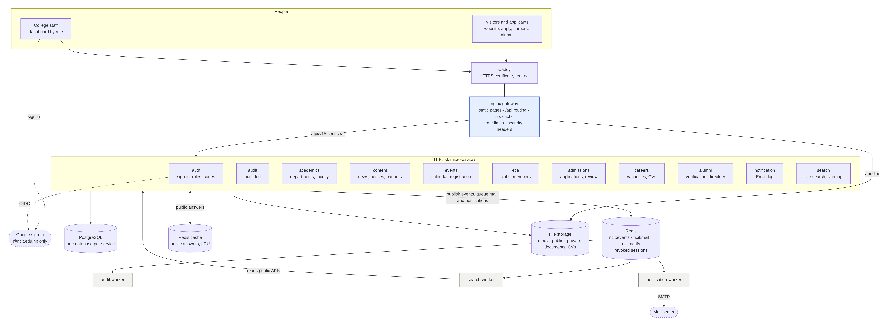
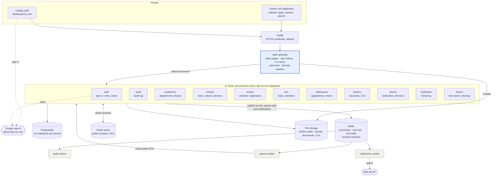
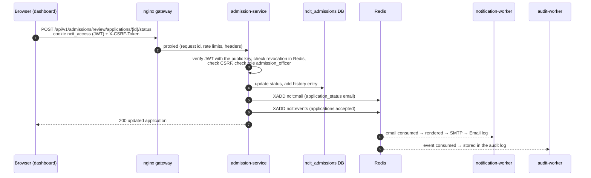
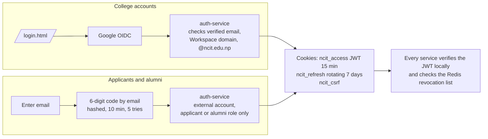
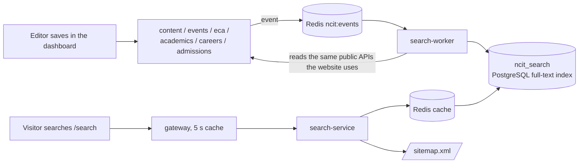
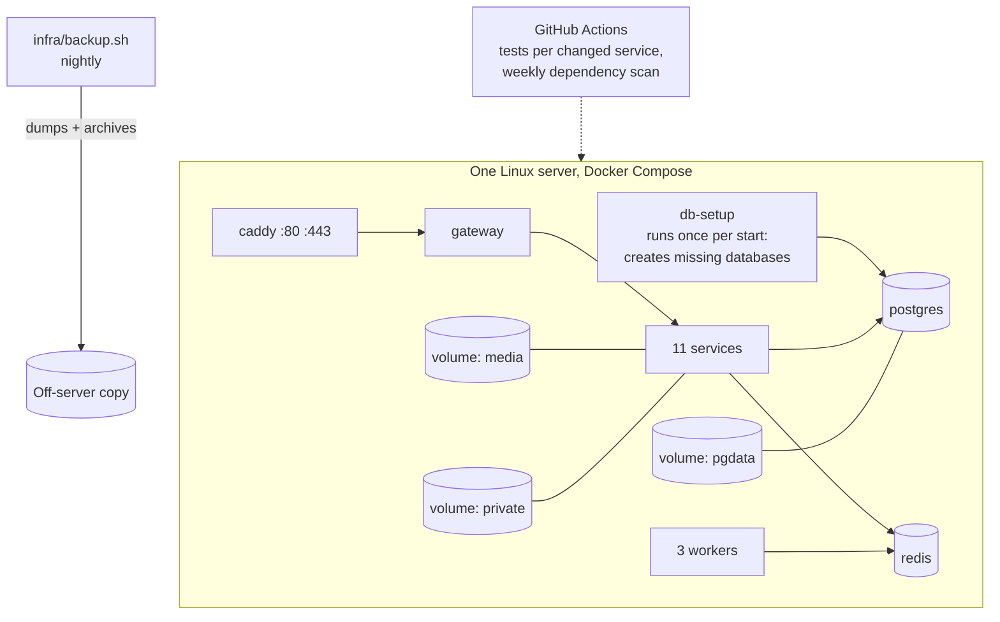

# How the NCIT website is implemented

The site is one nginx gateway in front of 11 independent Flask services. Each service owns its own PostgreSQL database and talks to the others only through a Redis event stream. The diagrams below are written in Mermaid, so GitHub draws them; the first is also saved as an image.



## 1. The whole system



**Rules every part follows:**
- **One way in.** Only the gateway is reachable from outside (only Caddy, with the HTTPS setup). Services listen on an internal network.
- **Each service owns its data.** No service reads another's database. Shared behaviour (token checks, roles, CSRF, uploads, editor routes, the mail queue) lives in the `ncit-common` library that every service imports.
- **Events, not calls.** A service announces a change ("news.published", "applications.accepted") on the Redis stream. The audit worker stores it in the audit log; the search worker re-indexes the affected section.
- **Mail is queued.** Services put emails on a separate stream (`ncit:mail`), so one-time sign-in codes never reach the audit log. The notification worker sends them and keeps the Email log.
- **Notifications are queued too.** In-app notifications (the bell) go on `ncit:notify`. The same worker stores them, and notification-service shows each person only their own and their roles'.
- **Private files stay private.** Application documents and CVs are stored where the gateway can't serve them. Only the owning service hands them out, after checking who is asking.

## 2. What happens on a request

A signed-in Admission Officer accepting an application:



Public pages (news, events, the home page data) are cached twice: for 5 seconds at the gateway, and in a separate Redis by each service, which drops its copies the moment anything changes. Most visitors never reach a database. Details: [CACHING-AND-NOTIFICATIONS.md](CACHING-AND-NOTIFICATIONS.md).

## 3. Sign-in



Removing a role or suspending an account takes effect on the user's next request: auth-service writes the revocation to Redis, and every service checks it.

## 4. How the search stays current



The search index only ever contains what the public can already see, because it is built from the public APIs. A full rebuild also runs every 15 minutes, as a safety net.

## 5. Deployment



| File | Role |
|---|---|
| `infra/docker-compose.yml` | Every service, worker, database, Redis and the gateway |
| `infra/docker-compose.tls.yml` | Adds Caddy for HTTPS; closes the gateway's own port |
| `infra/postgres/init/01-databases.sh` | Creates one database and login per service; safe to re-run |
| `gateway/nginx.conf` | Routing, caching, rate limits, security headers |
| `infra/backup.sh`, `infra/restore.sh` | Backups and restore |
| `.github/workflows/ci.yml` | Tests only what changed; weekly vulnerability scan |

## 6. Repository layout

```
frontend/            Public site and dashboard: HTML pages + Tailwind + plain JavaScript modules
  src/pages/         Page sources (built into public/ by scripts/build-pages.mjs)
  public/assets/js/  One module per page area (campus-pages.js, admissions-pages.js, dashboard-*.js …)
gateway/nginx.conf   The single entry point
libs/ncit-common/    Shared Python: auth, roles, CSRF, revocation, events, mail, fields, media, editor routes
services/<name>-service/
  app/               Flask app: models, routes (public / me / editor), rules
  migrations/        Alembic, run on start
  tests/             pytest
infra/               Docker Compose, database setup, backup and restore
tools/               security_check.py, load_test.py
docs/                Guides, reports and this file
```

## 7. Services at a glance

| Service | Database | Public routes | Signed-in routes | Editors |
|---|---|---|---|---|
| auth | ncit_auth | `/config` | `/me`, `/code/*`, `/google/*` | Super Admin (Users & access) |
| audit | ncit_audit | none | none | Super Admin (Audit log) |
| academics | ncit_academics | departments, faculty | none | HOD (own department), Super Admin |
| content | ncit_content | home, news, notices, leadership, contact form | none | Content Admin |
| events | ncit_events | events, calendar | register, cancel, my registrations | Event Admin |
| eca | ncit_eca | clubs, activities | join, leave, my clubs | ECA Admin |
| admissions | ncit_admissions | open intakes | my applications, documents | Admission Officer |
| careers | ncit_careers | vacancies | apply with CV, my applications | HR Officer |
| alumni | ncit_alumni | directory, featured | my profile | Alumni Coordinator |
| notification | ncit_notify | none | none | Super Admin (Email log) |
| search | ncit_search | search, sitemap.xml | none | Super Admin (status, rebuild) |
