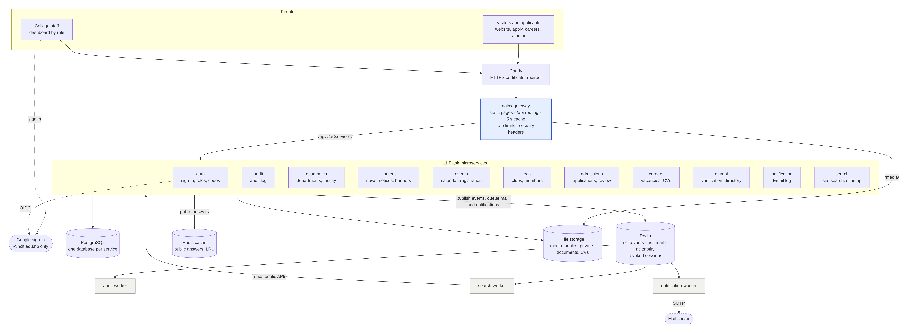

# Work log: every task completed

A complete record of the work done on the NCIT website, from the first design to launch readiness. Every task below is finished and tested. For *how* each phase was built, see [PHASES.md](PHASES.md); for diagrams of how the system fits together, see [ARCHITECTURE.md](ARCHITECTURE.md).

**Status:** all phases built and tested · security review done · Redis page cache and in-app notifications added · 11 services, 3 workers · 165 automated tests · waiting for the college's go-live sign-off ([GO-LIVE.md](GO-LIVE.md)).

## Commits

| Date | Commit | What |
|---|---|---|
| 2026-11-04 | (this commit) | Redis page cache, notification bell, sign-in and access fixes |
| 2026-11-04 | `cad3cc4` | Security review: 7 problems fixed, regression tests |
| 2026-11-04 | `e2e9a0c` | Docs: work log and architecture diagrams |
| 2026-11-03 | `917be88` | Phase 6: search, hardening and launch |
| 2026-11-02 | `826bc09` | Phase 5: admissions, careers and alumni |
| 2026-11-02 | `af5bb7b` | Phase 4: events, ECA and clubs |
| 2026-11-02 | `b01dffc` | Phase 2: content service |
| 2026-11-01 | `93b0b02` | Starter content for every department; HOD sign-in setup |
| 2026-11-01 | `fc3999f` | Phase 3: department pages managed from the dashboard |
| 2026-11-01 | `3baaca3` | Phase 1: Google sign-in, roles, access control, audit log |
| 2026-11-01 | `3b990ef` | Content edits moved into `src/`, photo fixes |
| 2026-11-01 | `2b19c5c` | Phase 0 files (pushed by the college) |

Each phase was delivered as a git bundle and a zip; the branch `phase-6-launch` holds everything.

---

## Phase 0: Foundations and design

- [x] Monorepo layout: `frontend/`, `gateway/`, `libs/ncit-common/`, `services/_template/`, `infra/`
- [x] nginx gateway with one route per service, security headers, caching and rate limits
- [x] Shared Python library `ncit-common` (JWT checks, role decorator, errors, logging)
- [x] Service template to copy for each new service
- [x] Docker Compose stack and PostgreSQL setup (one database per service)
- [x] GitHub Actions CI that tests only the services that changed
- [x] Design system in the "classic university" direction chosen by the college; colours sampled from the NCIT logo
- [x] Tailwind CSS v4 build, self-hosted fonts (Source Serif 4, Mukta), Lucide icon sprite
- [x] Page builder that assembles pages from shared header, footer and head partials
- [x] Home page, department page and dashboard shell, responsive and mobile first
- [x] Photo slots with labelled placeholders; "Sample" markers on invented content
- [x] Design review with desktop and phone screenshots; `DESIGN.md`, `PRODUCT.md`
- [x] Content and customisation guide for the college (`CONTENT-GUIDE.md`)

## Phase 1: Sign-in and access control

- [x] auth-service: Google sign-in limited to verified `@ncit.edu.np` Workspace accounts
- [x] 15-minute JWT access tokens (RS256) and rotating refresh tokens with reuse detection
- [x] HttpOnly cookies and double-submit CSRF protection
- [x] Instant revocation through Redis: a removed role stops working on the next request
- [x] Roles with department scope for HODs; invitations; role expiry dates; CSV import; suspension
- [x] Safety rules: at least one Super Admin; nobody can suspend themselves or remove their own Super Admin role
- [x] audit-service and audit-worker: every sign-in, refused sign-in and access change recorded from the Redis event stream
- [x] Login page with clear error messages; development login for local testing
- [x] Dashboard: real signed-in user, menu by role, Users & access, Audit log, demo mode
- [x] Gate checked: outside emails refused; revoked role loses access immediately
- [x] Guide: `PHASE-1-AUTH.md`

## Phase 3 (brought forward): Department pages and the HOD dashboard

- [x] academics-service: departments, programmes, semester-wise courses, faculty, labs, student testimonials
- [x] Photo uploads re-encoded for safety (hidden data such as location removed)
- [x] One page template for all 8 departments at `/departments/<name>`; home page list of departments
- [x] My department editor for HODs; Departments editor for the Super Admin (publish, hide, add)
- [x] HOD edits limited to their own department, even with crafted requests
- [x] Starter content for all 8 departments, marked "(sample)", never overwriting edits
- [x] HOD sign-in setup (`HOD_ASSIGNMENTS`) and demo HOD accounts
- [x] Gate checked: each HOD edits only their own department
- [x] Guide: `DEPARTMENTS.md`

## Phase 2: Core content

- [x] Field validation and safe uploads moved into the shared library
- [x] content-service: banners and ads with show-from/until scheduling, leadership messages, news with article pages, notices with PDFs, pinning and automatic removal, facilities
- [x] Live home page, with the built-in content kept as a fallback
- [x] New pages: `/news`, `/news/<article>`, `/notices`, `/leadership`
- [x] Website content section in the dashboard for Content Admins
- [x] Gate checked: Super Admin schedules a banner and publishes a leadership message end to end
- [x] Guide: `CONTENT.md`

## Phase 4: Events, ECA and clubs

- [x] Generic editor routes in the shared library (list, add, edit, delete, reorder, upload); content-service moved onto them
- [x] event-service: events, registration with places and closing time, automatic waiting list (row-locked), attendance, CSV export
- [x] eca-service: clubs, join requests with approval, committee positions, club activities
- [x] Public pages: `/events` (upcoming, past, month calendar), event pages with a register button, `/clubs`, club pages with "Ask to join"
- [x] Dashboard: Events and Registrations, Clubs and Members, Join requests, Club activities, My activity for everyone
- [x] Nepal time everywhere in the dashboard
- [x] Demo admin accounts for local testing
- [x] Gate checked: Event Admin and ECA Admin can't edit each other's content
- [x] Docs: `EVENTS-AND-CLUBS.md`, `PHASES.md` (phase-by-phase record)

## Phase 5: Admissions, careers and alumni

- [x] Shared mail queue (`ncit:mail`) and private file storage in the shared library
- [x] Sign-in by emailed 6-digit code for applicants and alumni (hashed, one use, 10 minutes, 5 tries, rate limited)
- [x] notification-service: email templates, SMTP or log-only sending, Email log with retry, codes removed after sending
- [x] admission-service: intakes, programmes on offer, online application with saving, private document uploads, reference numbers, review workflow, status emails, internal notes, CSV export
- [x] career-service: vacancies, applying with a CV, HR review (shortlist, interview, offer) with emails
- [x] alumni-service: registration, verification against college records, public directory, featured alumni on the home page
- [x] Public pages: `/admissions`, `/apply`, `/careers`, `/careers/<vacancy>`, `/alumni`, `/alumni/join`
- [x] Dashboard: Applications, Intakes, Programmes on offer, Vacancies, Job applications, Alumni verification, Email log; applicant and alumni accounts in Users & access
- [x] Gate checked: apply, review, status email and alumni verification work end to end
- [x] Guide: `ADMISSIONS-CAREERS-ALUMNI.md`

## Phase 6: Search, hardening and launch

**Pages**
- [x] About, Contact (with a rate-limited form that emails the college), Faculty directory, Privacy notice, Accessibility statement
- [x] Every placeholder link in the header and footer pointed at a real page

**Search and SEO**
- [x] search-service: PostgreSQL full-text search over all public content, re-indexed seconds after each edit
- [x] `/search` page and the header search panel
- [x] `sitemap.xml`, `robots.txt`, sharing (Open Graph) tags and canonical links, structured data for the college

**Security**
- [x] One set of security headers on every response (Content-Security-Policy, HSTS, Permissions-Policy and others)
- [x] Four packages upgraded to clear 98 published vulnerabilities; weekly dependency scan in CI
- [x] Automated security test suite: `tools/security_check.py` (47 checks)

**Accessibility**
- [x] axe audit of 65 page states (0 violations after fixes); keyboard, 400% zoom and reduced-motion checks

**Performance**
- [x] Load test tool and results: about 6,700 requests per second, 0 errors (`tools/load_test.py`)

**Deployment and operations**
- [x] Full Docker Compose deployment tested for the first time; four deployment bugs found and fixed
- [x] HTTPS with Caddy (`infra/docker-compose.tls.yml`)
- [x] Backup and restore scripts, proven by deleting all data and restoring it

**Handover documents**
- [x] `OPERATIONS.md`, `ADMIN-GUIDE.md`, `GO-LIVE.md`, `LAUNCH-READINESS.md`, `ARCHITECTURE.md`, this work log

## Security review and full test run

Details in [SECURITY-REVIEW.md](SECURITY-REVIEW.md).

- [x] Code review of sign-in, tokens, CSRF, every route's access check, HOD scoping, uploads, the gateway and the front end's HTML
- [x] Attacks on the running site: outsider accounts, other people's applications, forged tokens, CSRF, path traversal, search injection, faked addresses, open redirects
- [x] Stored-script (XSS) test: payloads in 78 fields, 73 page views in Chromium, 0 injected
- [x] 7 problems fixed, each with a regression test (see the bugs table)
- [x] Everything re-run: 146 tests, security checks 49/49 locally and 32/32 over HTTPS on Docker, browser end-to-end scripts

## Redis caching, notifications, and the sign-in and access review

Details in [CACHING-AND-NOTIFICATIONS.md](CACHING-AND-NOTIFICATIONS.md).

- [x] Redis page cache for every public API, dropped the moment anything changes; its own Redis container with LRU eviction; fails open
- [x] Gateway cache cut from 30 s to 5 s: edits reach the website within about 5 seconds
- [x] Measured: public answers 5.6 ms → 1.2 ms; department page 223 → 2,583 req/s; whole site 3,007 → 4,057 req/s with the slowest 1% at 103 ms instead of 762 ms
- [x] In-app notifications: a shared `notify()` queue, storage and an API in notification-service, the worker reads mail and notifications together
- [x] 11 kinds of notification: applications, job applications, alumni verification, club requests and decisions, waiting-list places, role changes
- [x] The bell in the website header and the dashboard: unread badge, mark as read, older pages; 0 accessibility violations; never loaded for visitors who aren't signed in
- [x] Sign-in and access re-checked; 2 fixes (role expiry, campus rate limits)
- [x] 19 new tests (165 in all); security checks 52/52 locally, 32/32 over HTTPS on Docker

---

## Bugs found by testing, and fixed

| Phase | Bug | Fix |
|---|---|---|
| 5 | An empty "second choice" was sent to PostgreSQL as text instead of NULL | Normalised before saving; test added |
| 5 | Sign-in codes stayed readable in email subjects in the Email log | Subjects redacted too |
| 5 | An "Uploaded" mark showed for a document never uploaded | Visibility fixed |
| 6 | API and file responses carried no security headers (nginx inheritance rule) | One set of headers applied everywhere |
| 6 | 7 services couldn't reach their databases under Docker | All passwords passed to the database container |
| 6 | A service added after launch would never get its database | Re-runnable `db-setup` on every start |
| 6 | After a container restart the gateway could route to the wrong service | nginx re-resolves service addresses every 5 seconds |
| 6 | Workers started before their tables existed | Workers wait for their service to be healthy |
| 6 | Event view tabs scrolled sideways at 400% zoom | Tabs wrap |
| Review | Open redirect after sign-in (`next=/%5Cevil.com`, `/%09/evil.com`) | Only plain same-site paths accepted, on the page and the server |
| Review | Applicant/alumni accounts (any email) could book event places and ask to join clubs | College accounts only (`require_college`) |
| Review | Faked `X-Forwarded-For` reached the audit log; behind Caddy all visitors shared one rate limit | Gateway trusts only Caddy's fixed address |
| Review | Replaced documents, CVs and photos stayed on disk | Old file deleted on replace |
| Review | Tokens weren't required to carry an expiry | `exp`, `iat`, `sub`, `aud`, `iss` required |
| Review | A line break in a Contact-form name made the email fail | Subjects kept to one line |
| Review | First start on an empty server could fail (database setup ran too early) | PostgreSQL health check over TCP |
| Access | A role with an expiry date kept working for up to 15 minutes after it expired | The access token ends at the earliest role expiry |
| Access | Everyone on campus shared one sign-in rate limit (one internet address) | Trusted campus networks exempt (`gateway/campus-networks.conf`) |

## Numbers at the end

| | |
|---|---|
| Services | 11: auth, audit, academics, content, events, ECA, admissions, careers, alumni, notification, search |
| Background workers | 3: audit, notification (emails and the bell), search |
| Databases | 11, one per service |
| Automated tests | 165 |
| Security checks | 52 of 52 pass (32 of 32 over HTTPS) |
| Accessibility violations | 0 across 65 page states |
| Dashboard roles | 8, plus students, staff, applicants and alumni |

## Left for the college

See [GO-LIVE.md](GO-LIVE.md):
- replace the sample content;
- set up the Google sign-in client and a mail server;
- provide the server and the domain;
- schedule backups;
- train staff;
- sign off.
